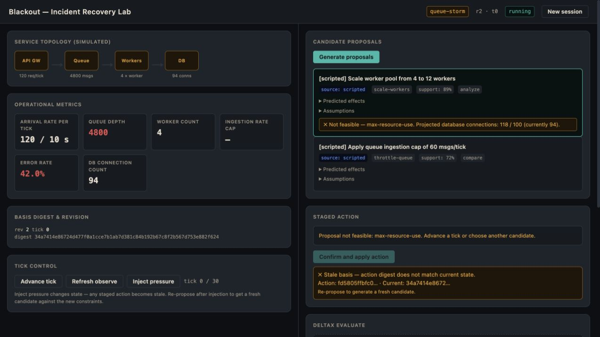

# Blackout local workspace verification — 2026-11-17

Scope: deterministic core, browser workspace, loopback HTTP and local execution boundaries. Hosted SDK is an unfinished separate work item, excluded from this verification. No Blackout provider call or credential was used.

## Independent results

- TypeScript strict compiler passed against the isolated M2 source set.
- 122 tests passed, 0 failed/skipped: existing invariants/examples plus workspace, HTTP boundaries and capacity regressions. Native command output: /private/tmp/blackout-capacity-tests.log.
- Node browser-script syntax check passed.
- Native browser clicks verified: create queue-storm seed42; stage scale from 4 to 12 (projected72/100 DB connections); inject pressure to 94; reject the old stage as stale; re-propose; refuse fresh scaling projected 118/100; stage and explicitly apply throttle at 60 messages/10 s once. After 3 simulated ticks, backlog 4615 from 4800 and error 35.9% from 42%. These are model outcomes, not measured process telemetry or Evaluate results.
- Refresh restored an existing session without erasing its recorded evidence.
- Exact effect/parameters and basis revision are visible before human confirmation; execute accepts only the server-owned stage ID. DNS-rebinding Host is rejected; GET inspection does not mutate the event log; source/digest checks and duplicate consumption remain enforced.

## Authorship and unresolved work

Kiro authored the original core/workspace and most integration source. Antigravity completed the downstream capacity guard and its regressions after Kiro's native monthly quota error. Codex independently reviewed, ran checks, fixed narrow runtime/UI integration issues and adjusted the HTTP recovery test to choose a feasible alternative. Actual session evidence is in KIRO-EVIDENCE.md.

Hosted transport/ledger, browser hosted review, measured process rig, final charts, release hosting, video and contest submission are not established by these tests. The initial hosted files failed protocol review and are being corrected before any credential creation. No mocked result may be represented as live service evidence.
